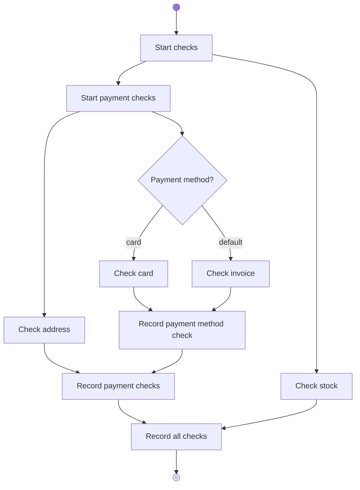
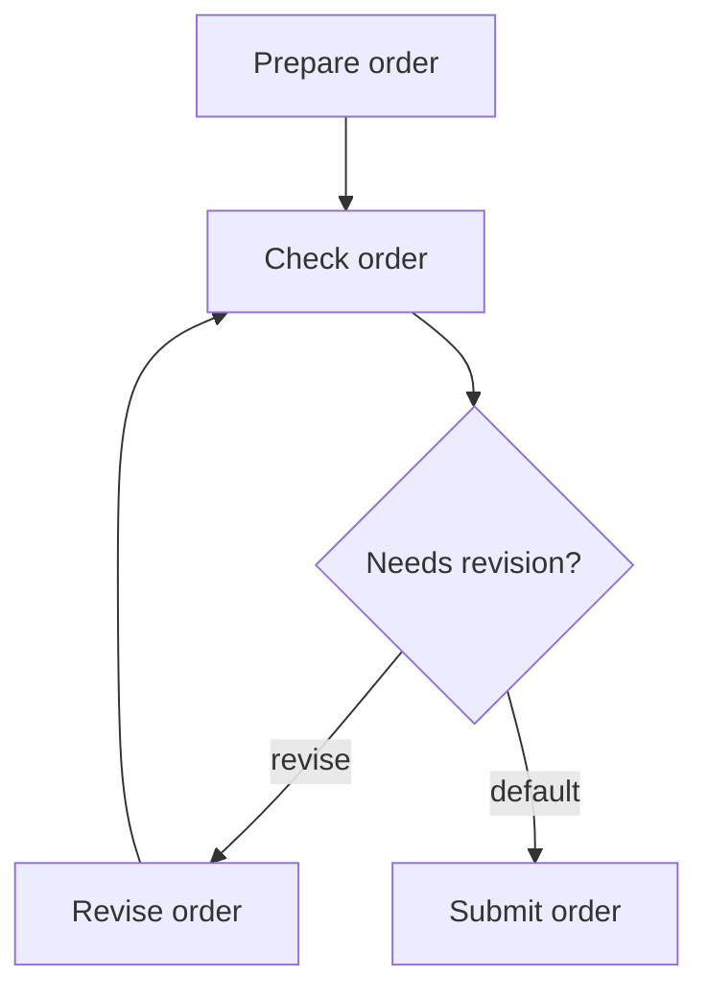
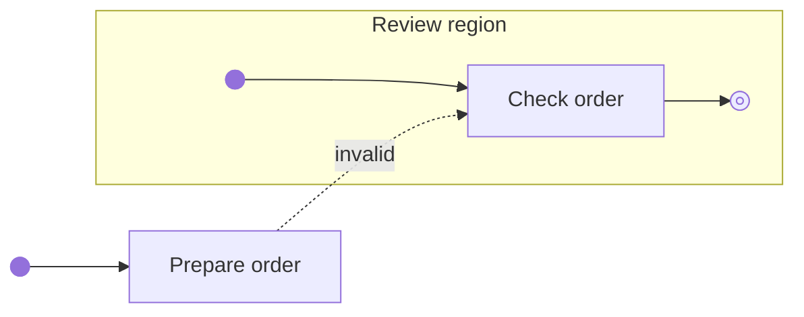
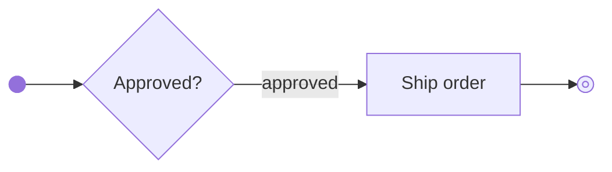

# Edges

## `Edge`

| Attribute | Type | Description |
| --- | --- | --- |
| `from` | `UUID` | ID of the node the edge leaves. |
| `to` | `UUID` | ID of the node the edge enters. |
| `branch` | `str` (optional) | Holds the branch label. Required on edges from a `DecisionNode`. |

Store explicit edges in `RegionNode.edges` for the region that directly contains the `from` node. This includes edges from that region’s `initial` node.

## Region entry and completion

The `initial` node has no incoming edges. The `final` node has no outgoing edges. Edges from `initial` and to `final` are internal to their region.

Edges connect nodes within the same region. An edge to a node in an enclosing region is an [interruptible edge](#interruptible-edge).

To enter a nested region, connect to its `RegionNode` in the enclosing region. Edges cannot connect directly to nodes inside a nested region from outside it. Execution starts inside the region at `initial` and follows the `RegionNode`’s outgoing edges after normal completion at `final`.

## Special edges

### Implicit edge

Add an implicit edge when a path through a region connects to either `initial` or `final`. If the path ends at `final`, add an edge from `initial` to its first node. If the path starts at `initial` and its last node has no outgoing edge, add an edge from that node to `final`. All edges from a `DecisionNode` must be explicit.

For `Step A → Step B → final`, add the implicit edge `initial → Step A`.

After adding implicit edges, check paths in the direction of execution. A valid path starts at the region’s `initial` node and ends at its `final` node or with an interruptible edge. Disable nodes that are not on any valid path.

### Branch edge

A `DecisionNode` has one edge per declared branch and one `default` edge. Execution follows the selected branch, or `default` if no named branch is selected. Branches can share a `to` node.

### Interruptible edge

An interruptible edge connects a child node to a child node in an enclosing region. Execution cancels the active paths and pending joins in each region it exits, then continues at the `to` node. A branch edge can also be interruptible.

## Edge patterns

The graph determines where paths split and which fork or decision they came from when they converge. A region’s `final` node can be a join or merge. The diagrams show the corresponding [UML activity nodes](https://www.omg.org/spec/UML/2.5.1/).

### Fork

When a non-decision node completes and has outgoing edges to two or more distinct targets, execution follows all of those edges. The paths can run concurrently.

### Join

A join waits for all paths from the same activation of a fork, then continues once. Track arrivals separately for each activation, including across region iterations. If a fork path contains a decision, its selected branch contributes one arrival to the join.

### Merge

Execution continues through a merge when the selected decision branch reaches it.

## Example workflows

These diagrams show execution patterns. A fork is represented by a non-decision node with multiple outgoing edges. Paths can join or merge at a regular node or at a region's `final`. A filled circle marks `initial`, and a filled circle inside a ring marks `final`.

### Nested forks and a decision

`Record payment method check` is a merge. It runs after the selected branch completes `Check card` or `Check invoice`. `Record payment checks` joins that merge's path with `Check address` from the same activation of `Start payment checks`. Its completion contributes one arrival to `Record all checks`, which also waits for `Check stock` from the same activation of `Start checks`. If this graph runs inside an iterating region, each iteration has its own fork activations.

### Cycle

An edge back to a preceding node repeats part of the workflow graph.

The `revise` branch runs `Revise order` and returns to `Check order`. Each traversal creates a new [node visit](EXECUTION.md#node_execution). The `default` branch exits the loop and continues to `Submit order`. The incoming edges at `Check order` allow entry on the first traversal and re-entry on each loop traversal.

### Invalid edge into a nested region

Reject the edge from `Prepare order` to `Check order`. To enter the nested region, target its `RegionNode` in the enclosing region. Execution then enters at the nested region's `initial`.

### Decision missing its default edge

Reject this decision because it lacks an explicit `default` edge. The validator cannot supply one as an implicit edge. A node that is not on any valid path is disabled under the [implicit edge rules](#implicit-edge).
