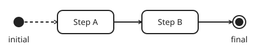
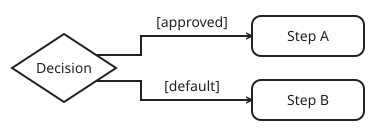
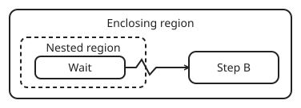
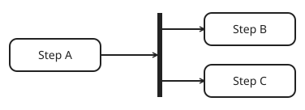
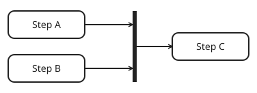
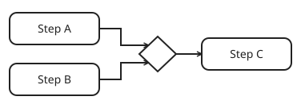

# Edges

## `Edge`

| Attribute | Type | Description |
| --- | --- | --- |
| `from` | `UUID` | ID of the node the edge leaves. |
| `to` | `UUID` | ID of the node the edge enters. |
| `branch` | `str` (optional) | Holds the branch label. Required on edges from a `DecisionNode`. |

Store explicit edges in `RegionNode.edges` for the region that directly contains the `from` node. This includes edges from that region’s `initial` node.

## Region entry and completion

The `initial` node has no incoming edges. The `final` node has no outgoing edges. Edges from `initial` and to `final` are internal to their region.

Edges connect nodes within the same region. An edge to a node in an enclosing region is an [interruptible edge](#interruptible-edge).

To enter a nested region, connect to its `RegionNode` in the enclosing region. Edges cannot connect directly to nodes inside a nested region from outside it. Execution starts inside the region at `initial` and follows the `RegionNode`’s outgoing edges after normal completion at `final`.

## Special edges

### Implicit edge

An implicit edge will be added when a path through a region connects to either `initial` or `final`. If the path ends at `final`, add an edge from `initial` to its first node. If the path starts at `initial` and its last node has no outgoing edge, add an edge from that node to `final`. All edges from a `DecisionNode` must be explicit.

For `Step A → Step B → final`, an implicit edge `initial → Step A` would be added.

After implicit edges are added, disable a node if it is disconnected from either `initial` or `final` in its region. Check connectivity using edges within that region, regardless of their direction.

### Branch edge

A `DecisionNode` has one edge per declared branch and one `default` edge. Execution follows the selected branch, or `default` if no named branch is selected. Branches can share a `to` node.

### Interruptible edge

An interruptible edge connects a child node to a child node in an enclosing region. Execution cancels the active paths and pending joins in each region it exits, then continues at the `to` node. A branch edge can also be interruptible.

## Edge patterns

The graph determines where paths split and which fork or decision they came from when they converge. A region’s `final` node can be a join or merge. The diagrams show the corresponding [UML activity nodes](https://www.omg.org/spec/UML/2.5.1/).

### Fork

When a non-decision node completes and has outgoing edges to two or more distinct targets, execution follows all of those edges. The paths can run concurrently.

### Join

A join waits for all paths from the same activation of a fork, then continues once. Track arrivals separately for each activation, including across region iterations. If a fork path contains a decision, its selected branch contributes one arrival to the join.

### Merge

A merge continues when the selected path from its decision arrives.
