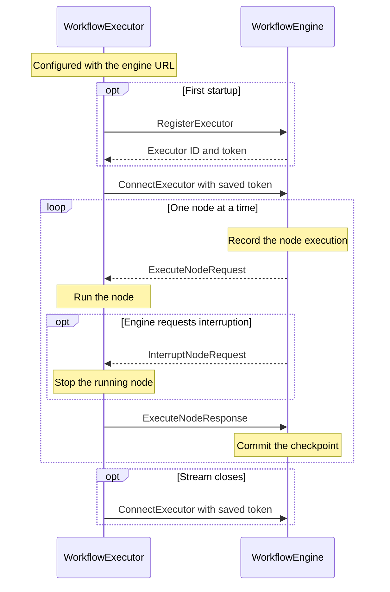

# Workflow execution

`WorkflowEngine` runs a saved [workflow revision](WORKFLOW.md#workflow) and checkpoints its progress in the database. The [node](NODES.md) and [edge](EDGES.md) specs define how execution moves through the graph.

## Components

### `WorkflowEngine`

`WorkflowEngine` orchestrates each `WorkflowExecution`. It determines which nodes should execute, manages timers and event waits, and dispatches node executions. It owns the workflow’s shared `DataMap` and records progress as concurrent branches advance.

### `WorkflowExecutor`

`WorkflowExecutor` runs node executions on a `Machine`. It registers with `WorkflowEngine`, runs the nodes the engine dispatches, and reports their outcomes. The engine dispatches `ActionNode` and `DecisionNode` executions to the executor, which calls their [Python entry point](WORKFLOW.md#executable-interface). The engine exclusively handles region executions, processes collection items sequentially, commits signals, and advances execution when waits end.

A `Machine` is a physical or virtual computer with its own execution environment, including installed software, environment variables, profiles, and secret references. Node executions use the environment of their assigned machine.

Nodes within a workflow execution can share a machine or target different machines. The two default executor aliases are `local`, which resolves to the executor on the user’s machine, and `sandbox`, which resolves to the built-in sandbox executor.

#### Protocol

1. `WorkflowExecutor` is configured with the `WorkflowEngine` URL.
2. On first startup, the executor calls `RegisterExecutor` over gRPC at that URL. The engine returns an executor ID and token, and the executor saves both.
3. The executor opens a bidirectional `ConnectExecutor` call and sends its saved token in the gRPC call metadata.
4. The engine records the node execution before sending an `ExecuteNodeRequest` to the selected executor. It sends the next node to that executor only after committing the current node's result.
5. The executor sends a `ExecuteNodeResponse` when the node finishes or stops in response to an interruption. The engine verifies that the sender is the assigned executor before committing the result.
6. The engine can send an `InterruptNodeRequest` while a node is running. The executor must be able to receive and process this message during execution.
7. The executor reconnects with its saved token after restart. A disconnect follows the [executor shutdown rules](#executor-shutdown).

Only one execution of a given node visit may run at a time. A failed node visit and its workflow remain `FAILED`.



##### APIs

###### `RegisterExecutor`

The engine creates an executor ID and token for a first-time registration.

```protobuf
rpc RegisterExecutor(RegisterExecutorRequest) returns (RegisterExecutorResponse)

RegisterExecutorRequest {}

RegisterExecutorResponse {
  executor_id: UUID
  token: str
}
```

###### `ConnectExecutor`

The engine sends `EngineMessage` envelopes, and the executor sends `ExecutorMessage` envelopes. Each envelope contains one typed payload. `node_xid` identifies the `node_execution` row.

```protobuf
rpc ConnectExecutor(stream ExecutorMessage) returns (stream EngineMessage)

EngineMessage {
  oneof payload {
    ExecuteNodeRequest execute_node
    InterruptNodeRequest interrupt_node
    EngineShutdown shutdown
  }
}

ExecutorMessage {
  oneof payload {
    ExecuteNodeResponse node_result
    ExecutorShutdown shutdown
  }
}

ExecuteNodeRequest {
  node_xid: UUID
  node: Struct
  inputs: optional DataMap
}

InterruptNodeRequest {
  node_xid: UUID
}

ExecuteNodeResponse {
  node_xid: UUID
  status: ExecutionStatus
  outputs: optional DataMap
  started_at: datetime
  ended_at: datetime
}

EngineShutdown {}

ExecutorShutdown {}
```

The executor reports `COMPLETED` when the node succeeds, `FAILED` when it encounters an unexpected error.

In `ExecuteNodeResponse`, `started_at` and `ended_at` record when the executor started and stopped running the node. A suspended result's `ended_at` records that stop and does not set the database row's terminal `ended_at`.

Include `outputs` only for a completed node with a nonempty return value, as defined by the [executable interface](WORKFLOW.md#executable-interface).

## Lifecycle

The lifecycle describes how a `WorkflowExecution` moves from creation to completion or failure.

| `ExecutionStatus` | Meaning |
| --- | --- |
| `RUNNING` | Execution is active, including while awaiting dispatch, a timer, an event, or a join. |
| `FAILED` | A node failed, ending the workflow. |
| `SUSPENDED` | Execution is paused and can continue from its saved progress. |
| `COMPLETED` | The root region completed under the applicable iteration, join, and merge rules. |

If a node fails, the engine marks that node and its workflow `FAILED` in the same transaction. It stops scheduling work for that workflow and interrupts its other running nodes. Results received after the workflow has failed cannot are ignored.

A workflow remains `RUNNING` while any of its nodes is running. It becomes `SUSPENDED` when no nodes are running and none of its suspended nodes can be scheduled. Engine shutdown follows the [shutdown steps](#engine-shutdown).

The engine creates executions in `RUNNING` and sets `started_at` at creation. It sets `ended_at` when an execution enters `FAILED` or `COMPLETED`. Waiting does not change the execution's status.

## Persistence model

`WorkflowEngine` stores workflow executions and their node executions in the database using the tables below.

### `workflow_execution`

| Column | Type | Description |
| --- | --- | --- |
| `id` | `UUID` | Primary key for the `WorkflowExecution`. |
| `workflow_id` | `UUID` | Identifies the source workflow. |
| `workflow_revision` | `int` | Identifies the saved revision. |
| `workflow_snapshot` | JSON | Stores an immutable copy of the `Workflow` used by the execution. |
| `status` | `ExecutionStatus` | Stores the workflow execution status. |
| `started_at` | `datetime` | Records when the execution was created. |
| `ended_at` | `datetime` (nullable) | Records when the execution ended. |
| `states` | JSON | Stores the current [DataMap](NODES.md#datamap), initialized from the validated [workflow inputs](WORKFLOW.md#workflow-inputs). |

### `node_execution`

| Column | Type | Description |
| --- | --- | --- |
| `id` | `UUID` | Primary key for one visit to the node. |
| `workflow_xid` | `UUID` | Foreign key to `workflow_execution.id`. |
| `node_id` | `UUID` | Identifies the node in the workflow snapshot. |
| `status` | `ExecutionStatus` | Stores the node execution status. |
| `inputs` | JSON (nullable) | Stores a fixed copy of the inputs saved before execution starts, including selected collection item values. Null until saved. An empty input object is stored as `{}`. Resuming a suspended visit uses these saved inputs. |
| `executor_id` | `UUID` (nullable) | Identifies the `WorkflowExecutor` assigned to the node execution. |
| `started_at` | `datetime` | Records when the node visit was created. |
| `ended_at` | `datetime` (nullable) | Records when the node visit ended. |

Each node visit has its own row. This includes concurrent visits on fork branches and successive visits in collection iterations. A loop or a later traversal to the same `node_id` creates a new row. Resuming a suspended visit uses the existing row and preserves its `started_at`.

## Region execution

`WorkflowEngine` processes a region's collection one item at a time. For each item, execution begins at `initial`. The engine starts the next item only after execution for the current item reaches `final`. The region completes normally after every item finishes. Nested collection regions follow the same rule.

An interruptible edge that exits the region ends its current iteration and prevents the remaining items from starting. Execution continues at the edge's target according to the [interruptible edge rules](EDGES.md#interruptible-edge).

## Node inputs and outputs

The engine validates workflow inputs against `Workflow.states` before initializing workflow state.

### Input copies

Before a node visit starts, the engine saves a copy of its selected inputs in [`node_execution.inputs`](#node_execution). This includes values selected from the current collection item or an enclosing region's current item.

Each node visit has its own saved inputs, including visits that run concurrently. The node receives a copy of its saved inputs, including when execution continues from `SUSPENDED`. Later changes to workflow state do not change these inputs.

### Output application

The engine applies completed nodes' outputs one at a time, in the order it receives their completion results. The engine applies all outputs from each node together in the checkpoint transaction.

When outputs overlap at the same state path, the output applied later takes precedence. For example, if two nodes output `payment.approved`, the result received second determines its final value. An output for `payment` also replaces its child values.

### Runtime validation

The engine validates inputs before execution, outputs before applying them, and signal payloads before committing events. Each value must match its state, item, or event schema.

Missing values, validation errors, or execution exceptions fail the node and its workflow. The engine rejects all outputs from a failed node.

## Dispatch and checkpoints

When a node becomes eligible to run, `WorkflowEngine` creates a `node_execution` row in `RUNNING`. Before dispatch, it saves inputs according to [Node inputs and outputs](#node-inputs-and-outputs) and records the selected executor. During suspension, it records successors as `SUSPENDED` without starting them; their inputs remain null until they start.

After each completed step, the engine records the node status, applies the node’s [state writes](WORKFLOW.md#node-state-bindings), records the next execution positions, and updates the parent status in one database transaction. A [Fork](EDGES.md#fork) creates its branch entry records in the same checkpoint. Concurrent branches can run independently. The engine serializes commits that update the same workflow execution and applies each completed node's state writes once.

## Checkpoint and restart

A normal shutdown saves unfinished work so execution can continue after restart. `WorkflowEngine` owns this process, including suspension of running nodes.

### Engine shutdown

1. Stop accepting new workflow executions and stop scheduling new nodes.
2. Allow running nodes to finish and process their results during the configured shutdown grace period (1 minute by default).
3. After grace period, mark all `RUNNING` workflows and node executions `SUSPENDED` in a database transaction. Ignore `ExecuteNodeResponse` received for suspended nodes.
4. Send each executor `EngineShutdown` and close its connection without waiting for a response.
5. After all executors disconnect, the engine shuts down.

### Executor interruption

The executor handles interruption messages as follows:

- `InterruptNodeRequest`: Stop the node execution identified by `node_xid` if it is still running.
- `EngineShutdown`: Stop all ongoing node executions.

### Executor shutdown

1. The executor stops all ongoing node executions.
2. The executor sends `ExecutorShutdown` and shuts down without waiting for a response.
3. On receiving `ExecutorShutdown`, the engine stops assigning work to that executor and marks its running nodes `SUSPENDED`.
4. The engine tries to reschedule those nodes on eligible executors, respecting executor bindings.
5. Whenever another node in an affected workflow completes, the engine checks its suspended nodes for scheduling again.
6. The engine marks the workflow `SUSPENDED` only when no nodes are running and none can be scheduled.

If the executor disconnects without sending `ExecutorShutdown`, the engine performs the same suspension and rescheduling steps when it detects the disconnection. 

### Engine restart

1. Mark workflows and node executions left in `RUNNING` as `SUSPENDED`.
2. Schedule suspended nodes when eligible executors are available.
3. Mark each resumed node and its workflow `RUNNING`.

