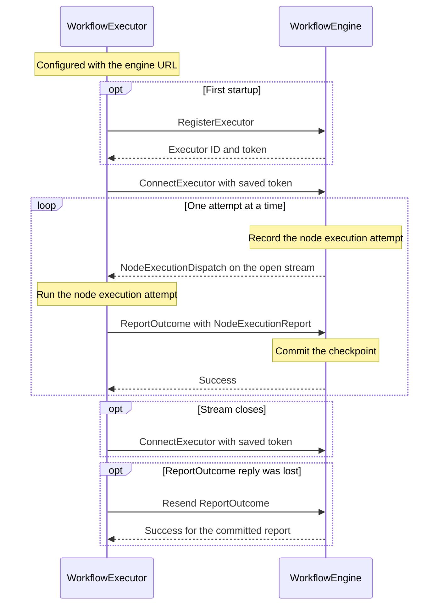

# Workflow execution

`WorkflowEngine` runs a saved [workflow revision](WORKFLOW.md#workflow) and checkpoints its progress in the database. The [node](NODES.md) and [edge](EDGES.md) specs define how execution moves through the graph.

## Components

### `WorkflowEngine`

`WorkflowEngine` orchestrates each `WorkflowExecution`. It determines which nodes should execute, manages timers and event waits, and dispatches node execution attempts. It owns the workflow’s shared `DataMap` and records progress as concurrent branches advance.

### `WorkflowExecutor`

`WorkflowExecutor` runs node execution attempts on a `Machine`. It registers with `WorkflowEngine`, runs the attempts the engine sends it, and reports their outcomes. For actions and decisions, it calls the node’s [Python entry point](WORKFLOW.md#executable-interface).

A `Machine` is a physical or virtual computer with its own execution environment, including installed software, environment variables, profiles, and secret references. Node execution attempts use the environment of their assigned machine.

Nodes within a workflow execution can share a machine or target different machines. The two default executor aliases are `local`, which resolves to the executor on the user’s machine, and `sandbox`, which resolves to the built-in sandbox executor.

#### Protocol

1. `WorkflowExecutor` is configured with the `WorkflowEngine` URL.
2. On first startup, the executor calls `RegisterExecutor` over gRPC at that URL. The engine returns an executor ID and token, and the executor saves both.
3. The executor calls `ConnectExecutor` with its saved token to receive node execution attempts on a server stream.
4. The engine records each attempt before sending it to the selected executor. It sends the next attempt to that executor only after committing the current attempt’s outcome.
5. When the attempt finishes, the executor calls `ReportOutcome` with its token and a report containing `node_xid`, status, outputs, and the attempt’s start and finish times. The engine looks up the node execution, verifies that the caller is its recorded executor, and returns success after committing the checkpoint.
6. If the stream closes, the executor calls `ConnectExecutor` again at the configured URL with the saved token. If the executor loses a `ReportOutcome` reply, it can resend the report. The engine acknowledges an already committed report without applying it again.



##### APIs

###### `RegisterExecutor`

The engine creates an executor ID and token for a first-time registration.

```protobuf
rpc RegisterExecutor(RegisterExecutorRequest) returns (RegisterExecutorResponse)

RegisterExecutorRequest {}

RegisterExecutorResponse {
  executor_id: UUID
  token: str
}
```

###### `ConnectExecutor`

The executor opens a server stream. When a node execution is ready for that executor, the engine sends a `NodeExecutionDispatch` with the node definition and its inputs. The `node_xid` identifies the `node_execution` row.

```protobuf
rpc ConnectExecutor(google.protobuf.Empty) returns (stream NodeExecutionDispatch)

NodeExecutionDispatch {
  node_xid: UUID
  node: Struct
  inputs: DataMap
}
```

###### `ReportOutcome`

The executor reports `COMPLETED` or `FAILED` for a finished attempt. For a completed action, `outputs` contains the action’s output attributes. The engine applies them to the workflow’s `DataMap` using the node’s `output_states` bindings. For a completed decision, `outputs.branch` contains the selected branch label, and the engine follows the corresponding edge. Use an empty `DataMap` when there are no outputs.

In the report, `started_at` and `ended_at` record when the executor started and finished the attempt.

```protobuf
rpc ReportOutcome(NodeExecutionReport) returns (google.protobuf.Empty)

NodeExecutionReport {
  node_xid: UUID
  status: ExecutionStatus
  outputs: DataMap
  started_at: datetime
  ended_at: datetime
}
```

## Lifecycle

The lifecycle describes how a `WorkflowExecution` moves from creation to completion or failure.

| `ExecutionStatus` | Meaning |
| --- | --- |
| `READY` | The execution has been created and is ready for the engine to begin. |
| `RUNNING` | The engine has begun and at least one path is active or can advance. |
| `WAITING` | Every remaining path is blocked on a timer or event, directly or through a join. |
| `FAILED` | An unrecoverable error ended the execution. |
| `COMPLETED` | The execution reached the root region’s `final` node under the applicable join or merge rules. |

Set `started_at` when creating the execution in `READY`. Set `ended_at` when it enters `FAILED` or `COMPLETED`. A timer or event can move a waiting execution back to `RUNNING`.

## Persistence model

`WorkflowEngine` stores workflow executions and their node executions in the database using the tables below.

### `workflow_execution`

| Column | Type | Description |
| --- | --- | --- |
| `id` | `UUID` | Primary key for the `WorkflowExecution`. |
| `workflow_id` | `UUID` | Identifies the source workflow. |
| `workflow_revision` | `int` | Identifies the saved revision. |
| `workflow_snapshot` | JSON | Stores an immutable copy of the `Workflow` used by the execution. |
| `status` | `ExecutionStatus` | Stores the workflow execution status. |
| `started_at` | `datetime` | Records when the execution was created. |
| `ended_at` | `datetime` (nullable) | Records when the execution ended. |
| `states` | JSON | Stores the current [DataMap](NODES.md#datamap), initialized from the launch inputs. |

### `node_execution`

| Column | Type | Description |
| --- | --- | --- |
| `id` | `UUID` | Primary key for one visit to the node. |
| `workflow_xid` | `UUID` | Foreign key to `workflow_execution.id`. |
| `node_id` | `UUID` | Identifies the node in the workflow snapshot. |
| `status` | `ExecutionStatus` | Stores the node execution status. |
| `executor_id` | `UUID` (nullable) | Identifies the `WorkflowExecutor` assigned to the current attempt. |
| `attempt_count` | `int` | Starts at zero before dispatch, becomes one on first dispatch, and increments on each retry. |
| `started_at` | `datetime` | Records when the node visit was created. |
| `attempted_at` | `datetime` (nullable) | Records when the latest attempt began. |
| `ended_at` | `datetime` (nullable) | Records when the node visit ended. |

A loop or a later traversal to the same `node_id` creates a new row. A retry updates the existing row and keeps its `started_at`.

## Dispatch and checkpoints

When a node becomes ready to run, `WorkflowEngine` creates a `node_execution` row in `READY`. Before dispatching the node to an executor, the engine updates that row to `RUNNING` and records `attempt_count` and the selected executor.

After each completed step, the engine records the node status, applies the node’s [state writes](WORKFLOW.md#node-state-bindings), records the next execution positions, and updates the parent status in one database transaction. A [Fork](EDGES.md#fork) creates its branch entry records in the same checkpoint. Concurrent branches can run independently. The engine serializes commits that update the same workflow execution and applies each accepted attempt’s state writes once.

## Recovery and open decisions

- Restore runnable node visits and workflow state from the last committed checkpoint. The policy for recovering in-flight executor work remains open, including when an action with external side effects can be retried and how to handle a resent report after a retry begins.
- Derive each wait’s configuration from the snapshotted `WaitNode`. The engine still needs a durable way to preserve timer deadlines and event delivery progress across restarts. The representation remains open.
- Keep join arrivals scoped to the same [Fork activation](EDGES.md#join). The representation for reconstructing activation membership and pending arrivals after a restart remains open, including for nested Forks and loops.
- Define the ordering of concurrent writes to overlapping state paths in the [state binding spec](WORKFLOW.md#statemap).
- Defer persisted node results and workflow or node failure details.
