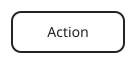
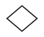
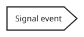
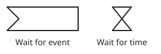
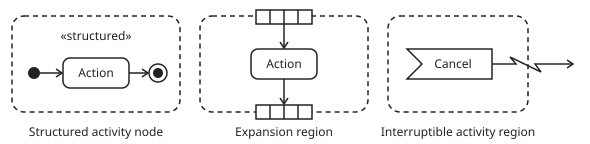

# Workflow nodes

The workflow model defines five node types. Every workflow embeds a root `RegionNode`, and regions can contain other regions. The workflow attributes and node state bindings are defined in [Workflow](WORKFLOW.md). [UML 2.5.1, chapters 13, 15, and 16](https://www.omg.org/spec/UML/2.5.1/PDF)

## `ActionNode`



Runs an arbitrary step and makes its outputs available to downstream nodes.

| Attribute | Type | Description |
| --- | --- | --- |
| `id` | `UUID` | Uniquely identifies the node. |
| `type` | `str` | Always `action`. |
| `instruction` | `str` | Describes the work to perform. |
| `inputs` | [TypeMap](#typemap) | Defines the input attributes and their types. |
| `outputs` | [TypeMap](#typemap) | Defines the output attributes and their types. |

It maps to UML's `Action`, the base class for executable steps.

## `DecisionNode`



Evaluates its inputs using a user-defined instruction and selects a branch.

| Attribute | Type | Description |
| --- | --- | --- |
| `id` | `UUID` | Uniquely identifies the node. |
| `type` | `str` | Always `decision`. |
| `instruction` | `str` | Describes how to choose a branch. |
| `inputs` | [TypeMap](#typemap) | Defines the input attributes and their types. |
| `branches` | `list[str]` | Defines unique, user-defined branch labels. The list may be empty. The label `default` is reserved. |
| `output` | `str` | Is the selected branch label from `branches`, or `default` when no named branch is selected. |

See [Branch edge](EDGES.md#branch-edge) for how branch labels determine outgoing edges.

It maps to UML's `DecisionNode` with guards on its outgoing edges.

## `SignalNode`



Signals an event and continues without waiting for a response.

| Attribute | Type | Description |
| --- | --- | --- |
| `id` | `UUID` | Uniquely identifies the node. |
| `type` | `str` | Always `signal`. |
| `event_id` | `UUID` | Identifies the [event](EVENTS.md#event) to signal in the workflow's workspace. |
| `inputs` | [TypeMap](#typemap) | Describes the payload attributes and types declared by the event. |

See [Events](EVENTS.md) for how the signal reaches matching waits.

It maps to UML's `SendSignalAction`.

## `WaitNode`



Pauses the current path for a duration, until a timestamp, or until a matching event instance arrives.

| Attribute | Type | Description |
| --- | --- | --- |
| `id` | `UUID` | Uniquely identifies the node. |
| `type` | `str` | Always `wait`. |
| `duration` | `timedelta` (optional) | Sets how long to wait. |
| `until` | `datetime` (optional) | Sets the timestamp at which the path resumes. |
| `event` | [EventSelector](#eventselector) (optional) | Selects the event instances that can resume the path. |
| `outputs` | [TypeMap](#typemap) (optional) | Describes the payload attributes and types when waiting for an event. |

Set exactly one of `duration`, `until`, or `event`.

The serialized time formats remain to be defined.

It maps to UML's `AcceptEventAction` with a `TimeEvent` or `SignalEvent` trigger.

## `RegionNode`



Runs a nested graph and can repeat it once per item in a collection.

| Attribute | Type | Description |
| --- | --- | --- |
| `id` | `UUID` | Uniquely identifies the node. |
| `type` | `str` | Always `region`. |
| `nodes` | `list[Node]` | Contains the child node definitions. |
| `edges` | [`list[Edge]`](EDGES.md#edge) | Contains the [edges](EDGES.md#edges) owned by the region. |
| `iteration` | `str` (optional) | Specifies the workflow state name or path containing the collection to iterate over. |

Each region has a built-in `initial` node for entry and a `final` node for completion. Each has its own UUID. Reaching `final` in a nested region completes that region execution. Reaching `final` in the root region completes the workflow execution.

A child node's enclosing region is determined by membership in `RegionNode.nodes`. When loading a workflow revision, `WorkflowEngine` can derive a node ID to enclosing region ID lookup. The root region has no enclosing region.

An iterating region completes normally when all iterations finish.

See [Interruptible edge](EDGES.md#interruptible-edge) for how an edge can exit a region before normal completion.

In UML, nesting maps to `StructuredActivityNode`, iteration to `ExpansionRegion`, and interruption to `InterruptibleActivityRegion`. The root region corresponds to an `Activity`. The built-in `initial` and `final` nodes serve the roles of UML's `InitialNode` and `ActivityFinalNode`, scoped to the region in our model.

## Types

### `EventSelector`

Selects an event by UUID and optional payload conditions.

| Attribute | Type | Description |
| --- | --- | --- |
| `event_id` | `UUID` | Identifies the [event](EVENTS.md#event) in the workflow's workspace. |
| `filter` | [FilterMap](#filtermap) (optional) | Payload conditions. Omit or leave empty to accept any payload. |

```json
{
  "event_id": "b12d61af-d5d4-4d7a-8577-93adf18b5f10",
  "filter": {
    "order.id": {"=": "order-123"},
    "amount": {">=": 100, "<": 1000}
  }
}
```

### `FilterMap`

Maps attribute paths to one or more operator–operand pairs. Paths support nesting, such as `order.id`. All conditions must hold.

| Operator | Operand | Condition |
| --- | --- | --- |
| `=` | Value | Equals. |
| `!=` | Value | Differs from. |
| `>` | Number | Greater than. |
| `>=` | Number | Greater than or equal to. |
| `<` | Number | Less than. |
| `<=` | Number | Less than or equal to. |
| `in` | List of values | Equals any listed value. |
| `not in` | List of values | Differs from every listed value. |


### `TypeMap`

A map from attribute names to `str`, `bool`, `number`, or another `TypeMap` for nested attributes. `number` includes integers and floating-point numbers.

```json
{
  "name": "str",
  "address": {"city": "str"},
  "amount": "number",
  "approved": "bool"
}
```

### `DataMap`

A `DataMap` holds concrete values for the attributes declared by a [TypeMap](#typemap). Each value must match its declared type. If an attribute is declared as a nested `TypeMap`, its value is a nested `DataMap`.

This `DataMap` matches the `TypeMap` above.

```json
{
  "name": "Jordan",
  "address": {"city": "Oakland"},
  "amount": 125.50,
  "approved": true
}
```
